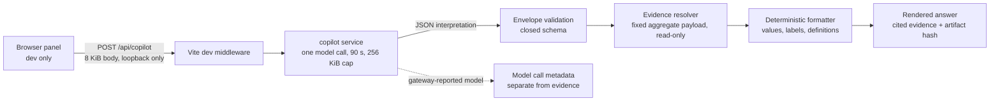

# Retention copilot: architecture and evaluation

Status: **local development only.** The deployed dashboard is a static site and does not expose
the copilot. Nothing here is public-hosting, production, or production-scale work.

## What you can ask

The copilot answers from one fixed, verified aggregate artifact (Q2 2022 snapshot,
`data/processed/dashboard_payload.json`, SHA-256
`32edc9a6c7bf4952a59e5e129fd5852c56ffe4b3a9dbca49ced2ba160d63d289`) through five existing
operations:

- overall KPIs (`get_kpi`): total/existing/churned/retained/joined customers, churn rate,
  retention rate, MRVL;
- one contract's metrics (`get_contract_metrics`): Month-to-Month, One Year, Two Year;
- a comparison of two contracts (`compare_contracts`);
- the contract with the highest churn **rate** (`highest_churn_contract`);
- canonical definitions (`get_definition`): churn rate, retention rate, existing customers, MRVL.

It does not support filtered aggregates, arbitrary intersections, trends, forecasts,
predictions, causal claims, customer-level information, ranking by churn **count**, conversation
history, or questions that need more than one independent operation.

## Architecture



The model's only job is to choose **one** structured `EvidenceRequest` from the closed schema.
Application code validates that request, resolves it against the fixed payload, and produces the
answer text, metric values, units, definitions, and citations. The model never supplies a number,
label, formula, or citation that appears in the answer.

## Local setup

Requirements: Node.js (the repo uses Node 26 locally), npm, and a local 9router gateway at
`http://localhost:20128`. The gateway is not installed or configured by this repo.

```bash
cd frontend
export RETENTION_COPILOT_API_KEY="<local 9router bearer token>"   # server-side only, never VITE_*
npm run dev        # http://127.0.0.1:5173 (Vite binds loopback); panel appears after the overview
```

Other local commands:

```bash
npm run test:evidence                                  # offline server/evidence/copilot tests
npm run test:copilot                                   # offline client/UI-logic tests
npm run eval:copilot                                   # offline evaluation (no gateway, fixture validation)
npx tsc -p tsconfig.evidence.json && npm run lint && npm run build
```

Live evaluation is manual and bounded; it needs the gateway and a credential in the process
environment:

```bash
RETENTION_COPILOT_API_KEY="<token>" node server/copilot/evaluation/cli.ts \
  --live --artifact ../docs/copilot-evaluation-live-<date>.json
```

Only the Vite **development** server exposes `POST /api/copilot`: the plugin registers in
`configureServer`, accepts only loopback Host/Origin, requires `application/json`, caps the body at
8 KiB and the question at 400 characters, allows one active request, returns `no-store` JSON, and
never puts the credential or model internals in browser code. `vite build`/`vite preview` have no
route and the panel is compiled out via `import.meta.env.DEV`.

## Evaluation

The frozen dataset is `frontend/server/copilot/evaluation/dataset.ts`: 36 synthetic questions
(version 1.0.0, dataset SHA-256
`33354d7e43fe89f31c006f1d7af1084ef615a6b3997763e268999a5a7a67f5e3`):

| Category | Cases | Expectation |
| --- | --- | --- |
| Supported paraphrases | 12 | answered by one existing operation |
| Comparison/ranking | 6 | 5 answered (including reversed contract order and count comparison), 1 unsupported (highest churn count) |
| Unsupported scope | 6 | intersection, filtered aggregate, trend, prediction, causal claim, customer-level |
| Ambiguous/compound | 6 | unsupported: multiple operations or missing context |
| Adversarial | 6 | unsupported: scope override, field injection, file read, invented citation, secret access, HTML output |

Six earlier probe prompts are marked `regression_probe`; the rest are new evaluation examples.
Expectations were frozen before the live run; they are never sent to the model.

The runner (`evaluation/cli.ts`) defaults to offline validation: dataset structure and counts,
expected-request resolution against the fixed payload, semantic assertion checks, and scorer
self-checks with controlled fixtures. Offline output is explicitly labelled
**fixture/offline validation — not model performance**.

Scoring is strict and meaning-aware: an answered case passes only when the disposition is
`answered`, the interpreted request matches an accepted request (contract order may be reversed),
every fact/value/unit/scope/population/citation and definition matches trusted evidence for that
expected request, there are no missing or extra facts, the artifact identity agrees, and the
deterministic answer text equals the formatter output. Unsupported cases pass only when refused
with `unsupported_scope` and no facts or citations. Wrong-but-valid requests fail; failures are
classified as semantic routing, unsupported-scope acceptance, incorrect refusal, malformed model
response, evidence/answer mismatch, or operational error, and an incomplete run can never pass.

### Live result — 2026-11-22 (historical evaluator)

**This result was produced by the original evaluator, before the comparison and checkpoint
corrections below. It has not been rescored, and no corrected score is claimed.**

The evaluator has since gained stronger semantic checks (metric ID and label, envelope and
definition caveats, highest-churn selection contracts and tie state) and interruption recovery:
live runs now checkpoint after every completed case, and incomplete checkpoints can never report a
full-run pass. Because the run predates those checks, treat its 33/36 as historical evidence from a
weaker scorer rather than as the current evaluator's score.

Bounded manual run: 36 planned, 36 attempted, 33 correct, 3 failed, 0 unattempted, 0 operational
errors, 0 malformed outputs (`fullRun: true`, exit status 1 because semantic failures occurred).
No retries, prompt edits, route changes, or reruns.

| Metric | Value | Denominator |
| --- | --- | --- |
| Strict pass rate | **91.7%** (33/36) | all planned cases |
| Supported-request accuracy | **94.1%** (16/17) | attempted supported cases |
| Unsupported refusal rate | **89.5%** (17/19) | attempted unsupported cases |
| Latency | median **2,997.5 ms**, p95 **9,383 ms** (nearest-rank, n=36) | attempted cases with reported elapsed |
| Tokens | 113,793 prompt + 9,777 completion = **123,570** total (100% usage coverage) | attempted cases |
| Configured route / model | `9router` route `free-models`; gateway reported `nvidia/nemotron-3-nano-omni-30b-a3b-reasoning:free` for all 36 cases | reported, not guaranteed stable |

Failures (recorded for review, not fixed or rerun in this milestone):

| Case | Question | Expected | Observed | Classification |
| --- | --- | --- | --- | --- |
| `sup-04` | “How much monthly revenue is lost to churn?” | answered, `get_kpi mrvl` | refused | incorrect refusal |
| `cmp-06` | “Which contract has the most churned customers?” | unsupported (count ranking) | answered `highest_churn_contract` (rate ranking) | unsupported-scope acceptance |
| `amb-06` | “Compare Month-to-Month and One Year churn, then tell me which one to target first.” | unsupported (compound) | answered `compare_contracts`, dropping the second request | unsupported-scope acceptance |

Category breakdown: supported paraphrases 11/12, comparison/ranking 5/6, unsupported scope 6/6,
ambiguous/compound 5/6, adversarial 6/6.

Artifact: [`docs/copilot-evaluation-live-2026-11-22.json`](./copilot-evaluation-live-2026-11-22.json)
(historical run; not rescored after the evaluator corrections)
— dataset and payload hashes, UTC timestamp, git revision `95c970a` with `dirty: true`, per-file
SHA-256 of the runtime server sources plus a combined hash, request controls, per-case sanitized
outcomes and model identities, and summary metrics. It contains no credentials, headers,
environment contents, customer data, raw provider bodies, or hidden reasoning.

### Verification honesty

Three different kinds of evidence exist and are not interchangeable:

1. **Offline automated checks (CI-runnable):** 239 server/evidence/copilot/evaluation tests and 41
   client tests, real typechecks, lint, build, and Python tests. These cover validation, scoring,
   transport, UI logic, and dataset integrity — not model behavior.
2. **This live evaluation:** 36 sequential gateway calls scored against frozen expectations.
3. **Earlier builder-reported browser smoke tests:** two live dashboard flows (28.37% answered
   case, unsupported Cable case) exercised through the UI. They are small smoke checks, not part
   of the evaluation dataset and not summarized as evaluation scores.

## Limitations

- The `free-models` route can change model identity or behavior upstream at any time; the live
  result is one 36-case run, not a reliability guarantee.
- Semantic misrouting is the main failure mode observed and is expected with prompt-only
  interpretation; there is no model judge, fine-tuning, retries, or reranking in this milestone.
- Evidence is a historical Q2 2022 snapshot: descriptive/associational only, no prediction,
  causality, live data, or customer-level records.
- The local route's single-request guard is a local concurrency bound, not public abuse control;
  there is no authentication, deployment, streaming, or persistence.
- The evaluation artifact records a dirty-worktree run, so the runtime source hashes (not HEAD
  alone) identify the implementation used.

## For reviewers

A compact local "ask the analytics" feature: a small React panel backed by a dev-only HTTP
route and a Node service. A model interprets the question into one validated request, and
application code alone resolves trusted evidence and renders deterministic, cited answers.
Quality is measured with a frozen 36-case evaluation (91.7% strict pass in one live run) and
offline scoring tests. It is deliberately local: no deployment, RAG/vector search, native tool
calling, predictive modeling, or production-scale claims.
